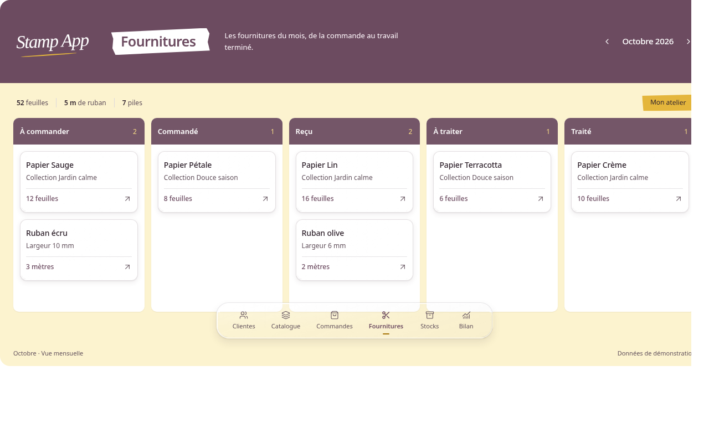
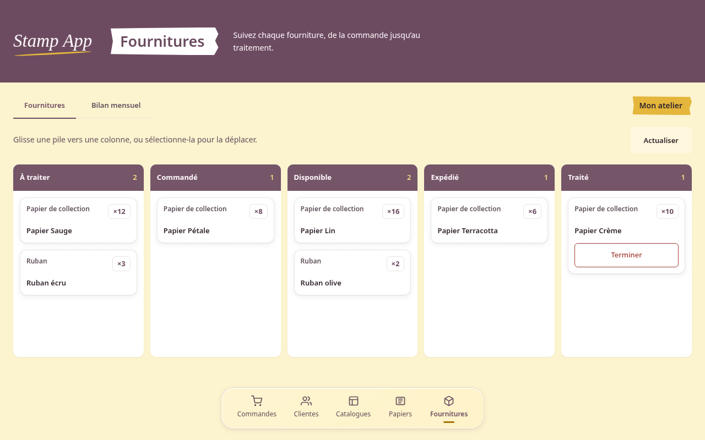

# Jalon 1 — socle et Fournitures

> Cadrage de livraison actualisé le 11 octobre 2026 : Chrome est utilisé par
> la cliente, Zen est validé par Sam et Safari est non testé, sans blocage.
> Les réserves Mac/Safari datées ci-dessous sont historiques ; voir la
> [validation actuelle de #39](../validation-issue39.md).

État au 9 octobre 2026 : Sam a autorisé la poursuite vers Commandes par
« Oui, passe à Commandes », en connaissance de la recette Safari/Mac restant
à compléter. Le jalon est accepté pour cette progression ; la validation sur
le Mac 13" et la clôture de l’issue #39 restent ouvertes.

## Comparaison à 1 280 × 800 CSS, zoom 100 %

| Maquette figée | Réalisation avec fixtures anonymes comparables |
| --- | --- |
|  |  |

Les captures utilisent Chromium/Linux, avec les mêmes noms et nombres de piles.
Le cadre d’export de la maquette a été retiré pour comparer à largeur identique ;
la source figée n’a pas été modifiée. Les polices Mac et le rendu Safari ne sont
pas validés par ces captures.

Différences explicites :

- Les états réels restent À traiter, Commandé, Disponible, Expédié, Traité.
  Les cartes affichent le type, le nom et la quantité en unités ; les collections,
  largeurs de ruban et mètres fictifs ne sont pas repris.
- Les onglets Fournitures / Bilan mensuel, Actualiser et Terminer sont conservés.
  Ils expliquent l’espace supplémentaire au-dessus du tableau et la hauteur
  différente des cartes. Aucun filtre mensuel n’est ajouté au Kanban.
- Le dock suit le contenu, au bas de la page, sans chevauchement. Il conserve
  les cinq destinations réelles dans leur ordre existant, dont Papiers ; le bilan
  reste un onglet de Fournitures. Contrairement au prototype, le dock ne flotte
  pas sur le bas des colonnes.
- Le bandeau conserve le logo complet, l’étiquette blanche et le contenu
  horizontal sur desktop. La description porte sur le workflow entier.
- Les contours des champs et les indicateurs de focus sont renforcés pour leur
  contraste. Les textes sont au minimum à 12 px ; les en-têtes à 13 px.
- Le verre utilise uniquement une couche CSS derrière le contenu, avec un voile
  blanc de 16 %, un bord optique et un repli blanc. Le moteur de réfraction SVG
  du prototype n’est pas importé. La perception du verre reste à valider sur Mac.

## Vérification locale

Les fixtures d’API sont créées dans une nouvelle base sous `/tmp` via
`backend/scripts/prepare-recette.js`, puis réparties dans les cinq états par
l’API de déplacement. Les noms longs, alertes et états d’erreur sont injectés
uniquement dans les réponses du navigateur. Aucune base du dépôt ou du NAS
n’est utilisée pour cette recette.

Contrôles effectués dans Chromium :

- 1 280 × 800, 1 440 × 900, 1 024 × 768, 640 × 800, 375 × 800 et 800 × 375 ;
  cinq colonnes sur desktop, repli en deux puis une colonne ; aucun débordement
  horizontal de la page et dock après le contenu.
- Premier Tab vers « Aller au contenu », activation du lien, navigation entre
  pages et focus du nouveau contenu ; Entrée/Espace sur une carte, Échap et
  retour du focus ; focus du dialogue existant.
- Déplacement partiel réel d’une unité, refus serveur 409 visible sans fermeture
  du dialogue, glisser-déposer avec destination verrouillée ; confirmation
  d’archivage affichée puis annulée, sans archivage réel.
- Bilan synthétique historique, noms longs et accents, alertes anonymes, cinq
  colonnes vides, chargement et erreur avec Réessayer.
- Mouvement réduit, absence de filtre sur le texte, repli sans filtre et
  préférence de transparence réduite émulée dans Chromium (fond blanc, aucun
  filtre sur la couche) ; les
  tests de contraste couvrent textes, compteurs, bordures de champs et repère
  actif du dock sur fond composé citron/verre.

Captures complémentaires : [desktop réel](fournitures-1280.png),
[1 024 px](fournitures-1024.png), [375 px](fournitures-375.png),
[noms longs et alertes](noms-longs-alertes.png), [déplacement](deplacement.png),
[confirmation](confirmation.png), [vide](vide.png), [chargement](chargement.png),
[erreur](erreur.png), [repli sans filtre](repli-sans-filtre.png).

`npm run check` et `docker compose config --quiet` passent. L’exécution des
tests API nécessite les ports locaux : elle a été réalisée avec l’autorisation
Codex adaptée, car le sandbox bloque les sockets. Ce blocage d’environnement
n’est pas présenté comme un défaut de l’application.

Le premier audit en lecture seule a signalé que le focus initial sautait le
lien d’évitement. Le comportement a été reproduit et corrigé : App, qui reste
montée entre les pages, déplace désormais le focus uniquement après un changement
de route. La correction est vérifiée dans le navigateur ; un second audit
indépendant n’a pas relevé d’autre défaut dans son périmètre. Le dernier audit,
après le garde-fou qui exclut la navigation initiale du routeur de la gestion
du focus, n’a pas identifié de défaut clavier ou responsive. Il a signalé
(pertinence 3/5) le bandeau ne contenant que le logo sur les autres routes :
confirmé dans les vues sans props de titre, ce rendu provisoire est conservé
jusqu’aux jalons concernés. Son adaptation anticipée est une décision de Sam,
pas une correction automatique de ce premier lot.

## Validation encore nécessaire avec Sam

- Viewport réel du Mac 13", Safari, zoom navigateur 200 % et clavier.
- Aspect du logo avec Snell Roundhand / Apple Chancery, étiquettes, palette,
  largeur et rendu du verre ; préférence de transparence réduite sur le Mac.
- Validation esthétique finale du jalon et de ses écarts sur le Mac.
- État ouvert du sélecteur de mois avant toute généralisation d’un nouveau style.

Le contrôle à 640 CSS px couvre un repli étroit ; il n’est pas une preuve de
recette Safari au zoom réel de 200 %. Les autres vues bénéficient du shell et
des tokens partagés, mais leur composition reste à traiter aux jalons suivants.
