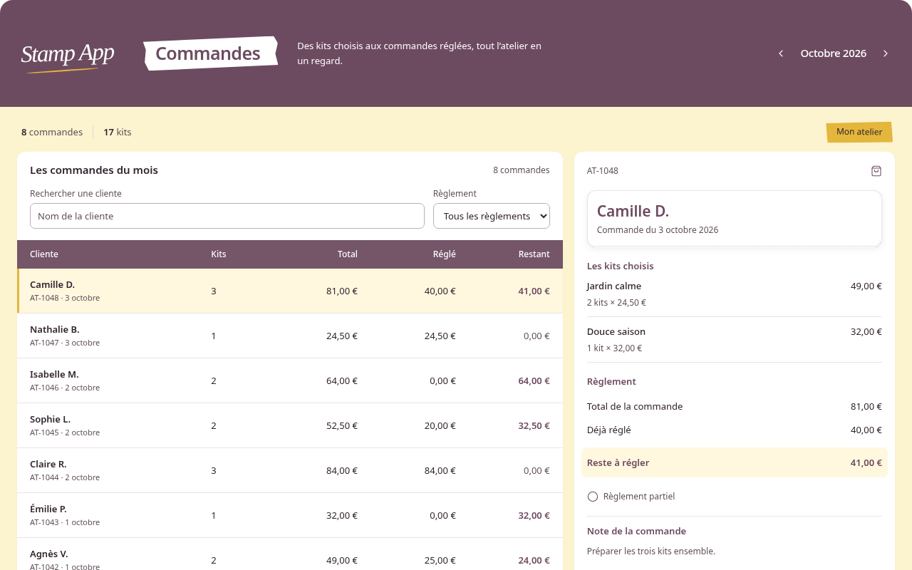
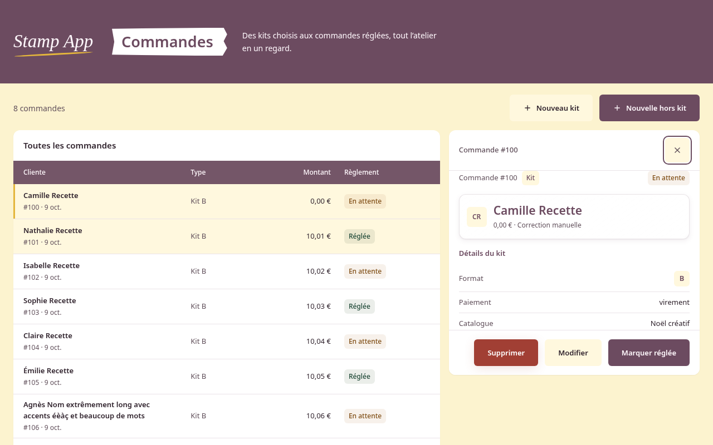
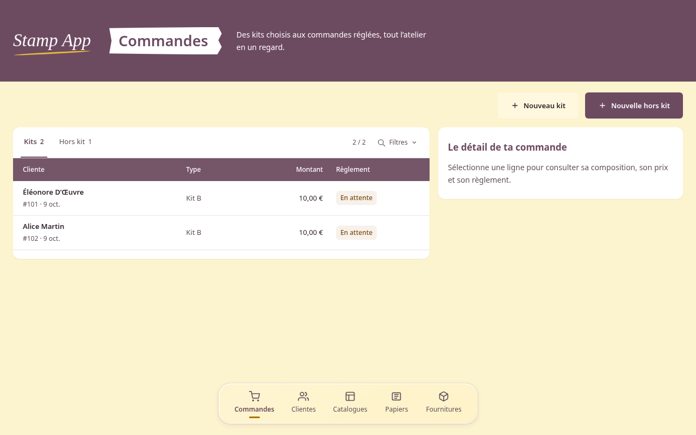
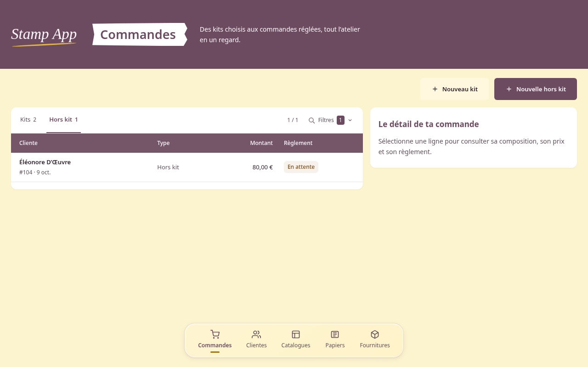

# Jalon 2 — Commandes

État au 9 octobre 2026 : rendu Commandes validé par Sam avec « Ouis beaucoup
mieux, je valide commande, commits et push, puis cadre la prochaine phase ».
Cette validation couvre les onglets intégrés, les filtres repliables et la
consultation. Les formulaires de création/modification restent à harmoniser
dans le jalon suivant. La recette Safari/Mac reste à compléter ; cette
validation ne vaut ni recette Safari réussie ni clôture de l’issue #39.

## Comparaison initiale à 1 280 × 800 CSS, zoom 100 %

| Maquette figée | Réalisation avec huit commandes synthétiques |
| --- | --- |
|  |  |

Cette première comparaison conserve la liste mixte du premier rendu. Sam a
ensuite demandé deux tableaux Kits/Hors kit, une recherche cliente et un filtre
catalogue le 9 octobre, puis a demandé leur intégration compacte au tableau.
Les captures à jour sont [onglets et filtres repliés](tableau-onglets-1280.png)
et [filtres dépliés](tableau-filtres-deplies-1280.png). Les captures
`kits-filtres-*` et `hors-kit-recherche-*` conservent le rendu précédent rejeté.

Les captures utilisent Chromium/Linux. Le cadre d’export a été retiré pour
comparer à largeur identique, sans modifier la source figée. Les polices Mac
et le verre Safari ne sont pas validés par ces captures. Les deux listes denses
continuent sous le viewport : toutes les lignes restent accessibles par
défilement de la page.

Différences explicites :

- Les quatre colonnes utilisent le contrat réel : cliente, type kit/hors-kit,
  montant appliqué, règlement binaire. Référence et date restent sous le nom.
  Aucun acompte, restant dû, note, multi-kits ou mois fictif n’est ajouté. Les
  filtres ajoutés sur demande explicite utilisent les commandes historiques.
- Les boutons « Nouveau kit » et « Nouvelle hors kit » occupent la barre
  d’actions ; compteurs et onglets sont dans le tableau. L’étiquette
  « Mon atelier » du prototype n’y est
  pas répétée. Le tableau conserve les noms complets et propose un bouton natif
  par ligne pour le clavier, avec une sélection citron et un repère jaune.
- Le détail conserve toutes les données historiques, plus nombreuses que dans
  la maquette : origine du prix, tarifs, papiers, quantités, matériaux,
  suppléments, paiement et cadeau selon le type. La carte cliente utilise le
  verre commun et expose immédiatement le montant appliqué et son origine.
- Sur desktop, liste et détail partagent la largeur selon le rapport 1,7 / 1.
  Le contenu du détail défile dans sa propre zone pour garder les actions dans
  le pied du panneau. À 900 CSS px et moins, le détail utilise le panneau modal
  existant ; il n’est pas empilé sous la liste comme dans le prototype.
- Le dock conserve les destinations réelles et suit le contenu sans le
  recouvrir. Les états vides, erreurs et commandes de nouvelle tentative sont
  conservés, ainsi que toutes les confirmations existantes.

## Vérification locale

L’API de recette utilise une base créée sous `/tmp` par
`backend/scripts/prepare-recette.js`. Les mutations réelles concernent seulement
des commandes synthétiques dans cette base. Les listes denses, noms longs et
refus serveur sont injectés uniquement dans les réponses du navigateur.
Aucune base du dépôt ou du NAS n’est utilisée.

Contrôles effectués dans Chromium :

- 1 280 × 800, 1 440 × 900, 1 024 × 768 et 375 × 800 ; liste/détail latéraux
  sur desktop, détail modal sur mobile, absence de débordement horizontal,
  changement de largeur avec le détail ouvert et libération du scroll de fond.
- Premier Tab vers le lien d’évitement ; ouverture par Entrée, focus du détail,
  Échap et retour à la ligne ; piège de focus modal dans les deux sens. Sur
  desktop, Échap hors du panneau ne ferme pas le détail.
- Édition kit : ancienne correction manuelle décochée, annulation sans mutation.
  Édition hors-kit : montant historique conservé à l’ouverture.
- Règlement hors-kit : refus serveur 409 visible, puis règlement réel sans
  recalcul. Pour kit et hors-kit réglés, absence de Modifier, Supprimer et
  Marquer réglée ; consultation historique toujours disponible.
- Suppression : confirmation annulée puis suppression réelle ; focus sur le
  titre de liste après disparition de la commande. Après règlement, fermeture
  vers le bouton courant de la ligne recréée par le rechargement du store.
- Formulaires de création kit/hors-kit et abandon : refus de l’abandon conserve
  le montant saisi, confirmation de l’abandon ferme le formulaire.
- Liens profonds `/?commande=<id>`, liste dense, nom long avec accents et montant
  manuel nul ; liste vide, erreur de liste avec Réessayer, erreur de détail
  puis rechargement réussi. Aucun événement d’erreur JavaScript relevé.
- Régression du composant partagé : le détail Clientes reste modal sur desktop,
  verrouille le scroll et se ferme avec Échap.

Captures complémentaires : [desktop réel](commandes-1280.png),
[1 440 px](commandes-1440.png), [1 024 px](commandes-1024.png),
[liste 375 px](liste-375.png), [détail 375 px](detail-375.png),
[liste dense 375 px](liste-dense-375.png), [kit réglé](kit-regle.png),
[hors-kit réglé](hors-kit-regle.png), [vide](vide.png),
[erreur de liste](liste-erreur.png), [erreur de détail](detail-erreur.png).

Les tests de rendu couvrent les champs réels du tableau, les compositions/prix
historiques, les suppléments gratuits et les protections des deux types réglés.
`npm run check` et `docker compose config --quiet` passent. Les tests API ont
été exécutés avec l’autorisation Codex adaptée aux sockets locaux.

Deux audits indépendants en lecture seule n’ont trouvé aucun défaut confirmé
dans leur périmètre. Ils n’ont pas rejoué la recette interactive Chromium.
Le retour de focus après recréation d’une ligne a été reproduit et corrigé
pendant cette recette, puis vérifié dans le navigateur. Le dernier audit a
examiné le diff corrigé ; son échec de la commande backend sous sandbox ne
remplace pas le résultat de la vérification autorisée effectuée séparément.

## Deux pages et filtres demandés le 9 octobre

La page Kits est accessible par `/commandes/kits` et par `/`, conservé pour
les anciens liens. Hors kit utilise `/commandes/hors-kit`. Les deux restent
sous la destination Commandes du dock. Les liens internes conservent les
paramètres utiles, retirent le détail lors d’un changement de tableau et
permettent le retour navigateur. Les anciens liens `/?commande=<id>` retrouvent
automatiquement le bon type, même pour une commande hors kit.

| Kits, recherche et catalogue | Hors kit, recherche cliente |
| --- | --- |
|  |  |

Contrôles supplémentaires effectués dans Chromium :

- Séparation stricte des deux types, compteurs par page, destination active
  du dock sur les deux routes et sur l’alias ; rechargement et retour navigateur.
- Recherche par prénom/nom, accents, casse, ligature œ et mots dans les deux
  ordres ; recherche limitée à la cliente, indépendante des titres de catalogue.
- Catalogue issu des snapshots, même historique/archivé ; plusieurs commandes
  du même identifiant regroupées malgré un changement de titre ; catalogues
  distincts ayant le même titre différenciés par leur identifiant.
- Recherche/catalogue combinés, aucun résultat avec sortie explicite, remise
  à zéro avec focus sur la recherche ; critères propres à chaque page pendant
  le passage Kits/Hors kit, réinitialisation au rechargement.
- Filtrage masquant le détail ouvert : fermeture, retrait du paramètre de détail
  et maintien du focus dans le champ de recherche.
- Création hors-kit depuis Kits, via le formulaire réel avec POST simulé dans
  le navigateur : résultat affiché dans Hors kit, sans commande NAS créée.
- 375 × 800, 800 × 375 et 1 024 × 768 : contrôles repliés, absence de
  débordement après transition, filtre combiné, ouverture/fermeture du détail.
- Suppression de la dernière commande d’un catalogue avec DELETE simulé :
  le filtre devenu indisponible est effacé, les autres commandes redeviennent
  visibles. Le décalage entre le libellé du menu et le critère actif a été
  reproduit avant correction, puis le même scénario réussit après correction.

Captures des contrôles : [375 px](kits-filtres-375.png),
[800 px en paysage](kits-filtres-800.png), [1 024 px](kits-filtres-1024.png).
Les captures des filtres désactivent les animations pendant la prise de vue
pour montrer leur état final. Les tests unitaires couvrent la séparation,
la normalisation des noms, la combinaison de critères et l’identité des
catalogues ; les tests SSR couvrent aussi le tableau propre à chaque type et
l’état sans résultat. Le scénario de suppression est vérifié séparément dans
le navigateur.

La vérification finale complète réussit : 92 tests backend, 55 tests frontend,
build Vue, configuration Docker et diff sans erreur d’espacement. Les audits
indépendants du lot filtres et de son état corrigé n’ont trouvé aucun défaut
concret ; ils ont exécuté tests frontend/build et contrôles Docker/diff, sans
rejouer la recette interactive. Les résultats Chromium ci-dessus ont été
vérifiés séparément par l’agent principal.

## Onglets intégrés et filtres repliables

Après le rejet du rendu précédent par Sam, les deux onglets remplacent le titre
visible « Commandes kits » dans l’en-tête du tableau. Ils utilisent un trait
prune sous l’onglet actif, sans fond de bouton. Le bouton discret « Filtres »
déplie les champs dans le tableau ; aucun popup ni dialogue n’est créé. Ils
sont masqués initialement. Un compteur signale les critères toujours actifs
une fois repliés ; leur détail reste consultable au dépliage et est annoncé
dans le nom accessible du bouton.

Recette Chromium à jour :

- Onglets dans l’en-tête, absence d’onglets dans la barre de création ; filtres
  fermés au chargement et après rechargement.
- Ouverture par Entrée, focus dans la recherche ; fermeture avec focus sur le
  bouton ; aucune modale ou restriction du scroll de fond ajoutée.
- Critères conservés pendant le repli et la navigation entre types, compteurs
  actifs actualisés ; reset depuis un état sans résultat replié conserve ce
  repli et rend le focus au bouton. Reset déplié rend le focus à la recherche.
- 1 280 × 800, 1 024 × 768, 375 × 800 et 800 × 375 : repli/dépliage dans le
  tableau sans débordement ; détail modal ou latéral inchangé.
- Fermeture du détail depuis `/commandes/kits` : URL conservée et focus à la
  ligne. Avant correction, le remplacement de query seul résolvait l’alias en
  `/` et déplaçait le focus au contenu principal ; ce scénario est reproduit
  puis corrigé par la conservation explicite du chemin dans le remplacement.

Captures : [desktop replié](tableau-onglets-1280.png),
[desktop déplié](tableau-filtres-deplies-1280.png),
[critères repliés actifs](tableau-filtres-replies-actifs.png),
[Hors kit](tableau-hors-kit-onglets-1280.png),
[375 px replié](tableau-onglets-375.png),
[375 px déplié](tableau-filtres-deplies-375.png),
[paysage replié](tableau-onglets-800.png),
[paysage déplié](tableau-filtres-deplies-800.png),
[1 024 px replié](tableau-onglets-1024.png).

La revue indépendante a signalé l’absence de valeurs des critères à l’état
replié. Le compteur visuel est conservé pour respecter la demande de masquage
et de compacité ; le nom accessible annonce désormais les valeurs. Afficher
des tags supplémentaires constituerait une autre composition à proposer à Sam.
La revue a aussi observé qu’une saisie composée d’espaces laisse disponible
« Effacer les filtres » malgré un compteur nul : la saisie brute peut être
effacée, tandis que le compteur compte les critères effectifs. Cette différence
n’est pas retenue comme un défaut de filtrage et reste inchangée.

La seconde revue a interprété « titre visible » comme le titre global
« Commandes ». Sam a demandé les onglets « au niveau de la ligne commande kit » :
ils remplacent bien ce titre dans le tableau, vérifié dans les captures. Ce
constat est donc écarté après confrontation à la demande exacte ; le cartouche
global validé par la maquette est conservé. Cette revue réussit tests frontend,
build, Docker et diff, sans rejouer le navigateur. La recette interactive et
la vérification complète réussissent séparément.

## Validation encore nécessaire avec Sam

- Validation de chaque nouvelle composition du jalon 3 (Clientes, Catalogues,
  Papiers et autres composants) selon le [cadrage proposé](../jalon3-cadrage.md).
- Safari sur le vrai Mac 13", viewport réel, zoom navigateur 200 %, clavier,
  polices du logo et perception du verre, transparence réduite.
- Recette consolidée des autres écrans et de l’état ouvert des contrôles de
  mois/date avant clôture de l’issue.

La recette Chromium à 375 px vérifie le repli ; elle ne prouve pas le résultat
du zoom Safari à 200 %. Le lot Commandes ne modifie ni API, ni schéma, ni règles
métier et reste non déployé.
